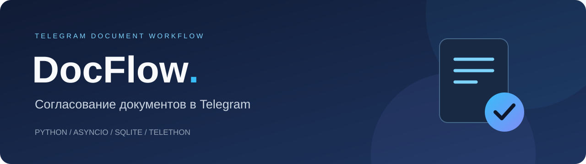
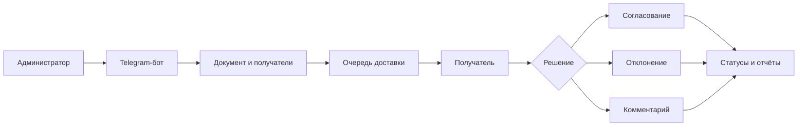

<div align="center">



**От документа до решения — прямо в Telegram.**


[Возможности](#возможности) · [Архитектура](#архитектура) · [Запуск](#запуск) · [Конфигурация](#конфигурация)

</div>

## О проекте

DocFlow — Telegram-бот для отправки документов на согласование и отслеживания ответов. Администратор выбирает получателей и отправляет материалы, а участники согласовывают документ, отклоняют его или оставляют комментарий. Напоминания и отчёты помогают следить за процессом.

Проект демонстрирует работу с асинхронным Python, Telegram Bot API и MTProto, хранением данных в SQLite, очередью отправки и отдельным веб-сценарием подключения аккаунта администратора.

## Возможности

- **Согласование документов:** отправка файлов, решения получателей и комментарии.
- **Адресная доставка:** контакты по телефону и username, ссылки на документы и приглашения.
- **Очередь отправки:** отслеживание статусов доставки и повторные попытки.
- **Напоминания:** фоновые задачи для незавершённых согласований.
- **Отчётность:** статистика и формирование отчётов в PDF и TXT.
- **Два языка:** русский и английский интерфейс.
- **Подключение аккаунта:** веб-форма для телефона, кода Telegram и 2FA; шифрование сохранённых сессий через Fernet.

## Как это работает



## Архитектура

| Компонент | Назначение |
| --- | --- |
| `main.py` | Обработчики бота, контакты, документы, очередь, напоминания и отчёты |
| `config.py` | Загрузка настроек из окружения |
| `database.py` | Подключение к БД авторизации и применение SQL-миграций |
| `auth_bot.py` | Совместимость основного бота с модулем сессий |
| `services/` | Подключение Telegram-аккаунтов, шифрование, аудит и ссылки авторизации |
| `repositories/` | Доступ к данным сессий, токенов и аудита |
| `web/` | HTTP-формы подключения аккаунта администратора |
| `migrations/` | Схема хранения авторизации и аудита |

Основная логика пока сосредоточена в `main.py`; авторизация вынесена в отдельные слои. Это прототип для портфолио, дальнейшее развитие которого — разделение обработчиков и покрытие интеграционных сценариев тестами.

## Запуск

Нужны **Python 3.12**, токен бота от **@BotFather** и собственные Telegram API ID / API Hash.

```bash
git clone https://github.com/pinkpank26/TG-Bot-DocFlow.git
cd TG-Bot-DocFlow
python3 -m venv .venv
source .venv/bin/activate
pip install -r requirements.txt
cp .env.example .env
```

На Windows: `py -3.12 -m venv .venv`, затем `.venv\Scripts\activate` и `copy .env.example .env`.

Сгенерируйте ключ шифрования и запишите результат в `SESSION_ENCRYPTION_KEY` внутри локального `.env`:

```bash
python -c "from cryptography.fernet import Fernet; print(Fernet.generate_key().decode())"
```

Заполните остальные обязательные значения и запустите:

```bash
python main.py
```

Бот создаёт таблицы основной БД и применяет миграции БД авторизации при запуске. Откройте своего бота и отправьте `/start`. Административные функции доступны пользователю с ID из `DEVELOPER_ADMIN_ID`.

## Конфигурация

| Переменная | Назначение |
| --- | --- |
| `BOT_TOKEN` | Токен Telegram-бота |
| `TELEGRAM_API_ID` | ID собственного Telegram API приложения |
| `TELEGRAM_API_HASH` | Hash собственного Telegram API приложения |
| `DEVELOPER_ADMIN_ID` | Telegram ID администратора; `0` — безопасное значение-заглушка |
| `SESSION_ENCRYPTION_KEY` | Уникальный секрет для шифрования сессий |
| `CONTACTS_DB_PATH` | БД контактов и документов; по умолчанию `universal_contacts.db` |
| `DB_PATH` | БД авторизации и аудита; по умолчанию `bot.db` |
| `WEB_AUTH_HOST` | Адрес HTTP-сервера; по умолчанию `127.0.0.1` |
| `WEB_AUTH_PORT` | Порт HTTP-сервера; по умолчанию `8081` |
| `WEB_AUTH_BASE_URL` | Адрес, используемый в ссылках подключения аккаунта |

### Подключение аккаунта администратора

Выберите подключение Telegram в интерфейсе бота и откройте выданную ссылку. Телефон, код и пароль 2FA вводятся в веб-форме. Ссылка ограничена по времени; сессия сохраняется в зашифрованном виде.

Для доступа с другого устройства настройте HTTPS reverse proxy и укажите публичный адрес в `WEB_AUTH_BASE_URL`. Встроенный HTTP-сервер предназначен для прототипа; перед публичным развёртыванием требуется отдельная проверка авторизации, защиты форм и ограничения запросов.

## Данные и приватность

Репозиторий содержит исходный код и пример конфигурации с пустыми секретами. `.env`, базы, Telegram-сессии, состояния диалогов, логи и выгрузки исключены через `.gitignore`. Для демонстрации используйте отдельного бота и вымышленные контакты.

Сохраняйте ключ шифрования отдельно от базы: его потеря делает сохранённые сессии недоступными. Не передавайте реальные токены, коды входа и файлы сессий через issues и pull requests.

## Проверка исходников

```bash
python -m compileall -q main.py config.py database.py auth_bot.py services repositories web
pip check
```

GitHub Actions проверяет синтаксис Python, совместимость установленных зависимостей и применение SQL-миграций к пустой SQLite-базе. Полный сценарий доставки требует отдельно настроенного Telegram-бота и тестовых аккаунтов.
